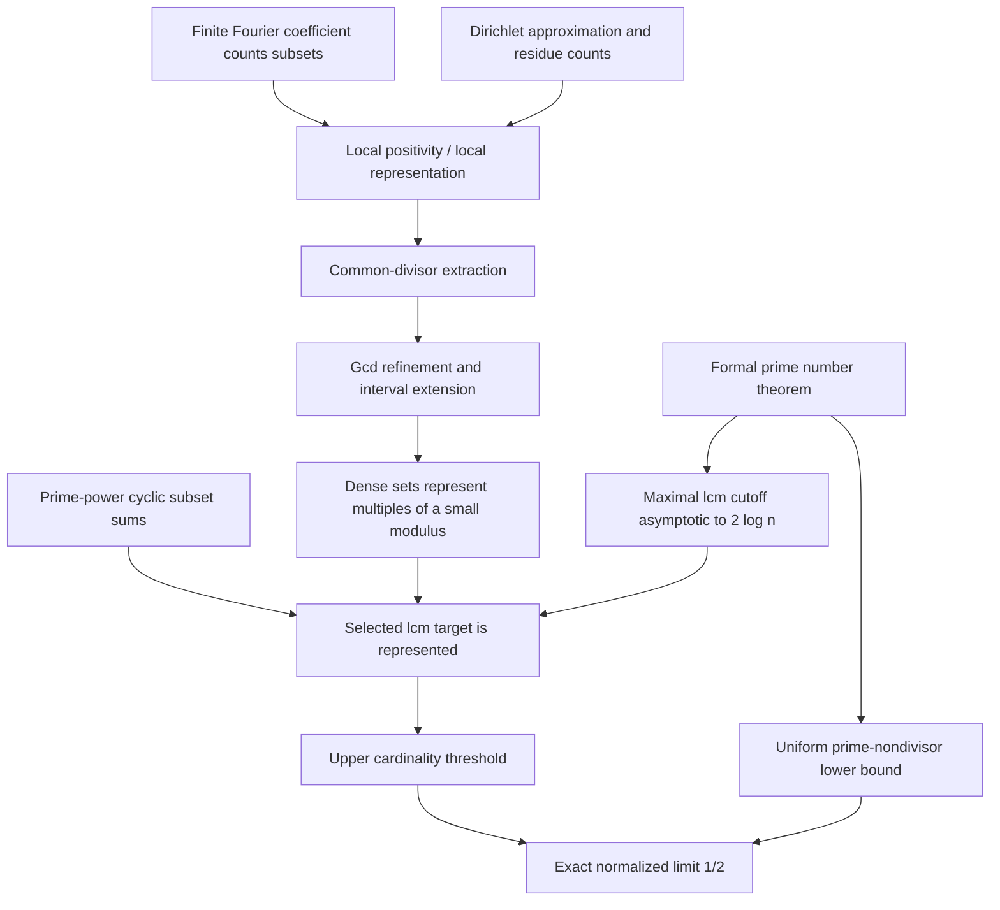

# JSP-000632 research feasibility audit

Research date: 30 October 2026 (Hong Kong). Verification completed at 12:17 HKT, within the initial budget. Original proof development stopped early under the requested stop conditions.

## A. Executive verdict

**NO-GO for a fresh, original first-formalization prize submission within this initial research budget.**

The intended interval problem, Erdős #771, has a complete mathematical solution **and an earlier public Lean formalization that we independently compiled successfully**. Both final theorem axiom audits returned only `propext`, `Classical.choice`, and `Quot.sound`. A separate compiled bridge checks the original explicit subset-sum formulation against that proof's definitions.

The official catalogue's description is materially less precise and refers to an arbitrary finite integer set, whereas the paper and #771 use the interval `{1,…,n}`. This remains a submission-target discrepancy. The verified prior proof establishes the interval result; it does not settle an unspecified arbitrary-host generalization or establish an official prize award.

Original proof construction was stopped at this audit gate. Reproducing and inspecting an earlier proof does not make it our original contribution. The small independent Lean experiment is statement validation and preliminary mathematics, not a solution of JSP-000632.

## B. Exact mathematical target

Let

\[
\Sigma(S)=\{\sum_{a\in A}a:A\subseteq S\},\qquad
P(n,k)\iff\forall m\in\mathbb N_{>0}\;\exists S\subseteq\{1,\ldots,n\}:
|S|=k\ \land\ m\notin\Sigma(S).
\]

Define

\[
f(n)=\max\{k\in\{0,\ldots,n\}:P(n,k)\}.
\]

The target is

\[
\boxed{\lim_{n\to\infty}\frac{f(n)}{n/\log n}=\frac12.}
\]

The logarithm is natural. The set `S` may depend on `m`. Empty subsets are included; their sum is zero, and `m>0` is essential. Finsets encode distinct elements, not a multiset. Values at `n=0,1` do not affect the limit. This is the precise question in the [Erdős #771 source](https://www.erdosproblems.com/latex/771).

The independently authored Lean declaration in `StatementAudit.lean` is:

```lean
def Avoids (m : ℕ) (S : Finset ℕ) : Prop :=
  ∀ A : Finset ℕ, A ⊆ S → (∑ a ∈ A, a) ≠ m

def AdmissibleCard (n k : ℕ) : Prop :=
  ∀ m : ℕ, 0 < m → ∃ S : Finset ℕ,
    S ⊆ Finset.Icc 1 n ∧ S.card = k ∧ Avoids m S

noncomputable def extremal (n : ℕ) : ℕ := by
  classical
  exact Nat.findGreatest (AdmissibleCard n) n

def ExactTarget : Prop :=
  Tendsto (fun n : ℕ =>
    (extremal n : ℝ) / ((n : ℝ) / Real.log (n : ℝ)))
    atTop (𝓝 (1 / 2 : ℝ))
```

`ExactTarget` is a **definition of the goal**, not a theorem proving it. The prior candidate's actual theorem is `Erdos771.erdos_771`, with the same limit and its own equivalent extremal definition.

The [pinned JSP catalogue](https://github.com/TheJustinSunPrize/awards/blob/fbaf42fcf8cfc036e00e9ae58a367155e8283e5a/problems/catalog-0601-0700.md#JSP-000632) supplies neither this formula nor its quantifiers. Arbitrary equal-size hosts cannot simply be substituted by order: `{1,2}` represents target `3`, whereas `{2,4}` avoids it. This observation exposes the missing specification; it does not refute every conceivable arbitrary-host generalization. We have not silently adopted such a generalization.

## C. Mathematical resolution and proof dependencies

Write `F(n,m)` for the largest size of a subset of `[1,n]` avoiding the fixed positive target `m`. Downward closure gives `f(n)=min_{m>0} F(n,m)`.

Alon–Freiman Theorem 1.2 gives, for each fixed `ε>0` and sufficiently large `n`,

\[
3n^{5/3+\varepsilon}<m<\frac{n^2}{20(\log n)^2}
\quad\Longrightarrow\quad
F(n,m)=\lfloor n/s\rfloor+s-2,
\quad s=\min\{d\ge1:d\nmid m\}.
\]

Together with the uniform Erdős–Graham lower bound, its lcm consequence resolves #771 completely. It does not determine `F(n,m)` for every `m`, nor solve the unspecified arbitrary-host wording. See [the original paper, pp. 298–305](https://web.math.princeton.edu/~nalon/PDFS/Publications/On%20sums%20of%20subsets%20of%20a%20set%20of%20integers.pdf).

An independent reconstruction checks the quantifiers and ranges as follows. For any fixed `c>2`, PNT makes the product of primes through `ceil(c log n)` larger than `n²`. Every positive target up to `n(n+1)/2` therefore has a prime nondivisor in this range; its multiples give a large avoiding set. Larger targets are avoided by the whole interval. This gives `liminf ≥ 1/2`.

For the upper bound take `X=floor(n²/(40 log² n))`, let `r` be maximal with `L(r)=lcm(1,…,r)≤X`, and set `m=L(r)`. Then `X/(r+1)<m≤X` and PNT gives `r~2log n`. Thus `m` lies in the theorem's range for any fixed `0<ε<1/3`, and its least nondivisor is `r+1`. Normalizing the exact formula gives `limsup ≤ 1/2`. Floors and the additive `O(log n)` term vanish after normalization.



| Significant ingredient | Required role | Stock Mathlib support at the pin | Additional engineering |
|---|---|---|---|
| Finite subset sums and downward closure | Interpret the extremal function | `Finset.subsetSum`, `mem_subsetSum_iff`, `subsetSum_mono` | Low; independent audit file checks the interpretation |
| Prime-nondivisor construction | Lower bound uniformly over targets | Divisibility, primorial and Chebyshev identities | PNT asymptotics come from the candidate's vendored PNT project |
| Coefficient-count identity | Convert positive Fourier integral to representation | Complex exponential integration and finite sums | Custom expansion and normalization; substantial |
| Rational-grid energy estimate | Control the integral away from zero | `Real.exists_rat_abs_sub_le_and_den_le` | Custom occupancy inequalities and uniform bounds; high |
| Local subset-sum representation | Start a progression of represented integers | General analysis tools | Custom quantitative positivity theorem; high |
| Divisor extraction and gcd descent | Get a long interval of multiples | Finset, divisibility and finite groups | Exact loss budgets, distinctness and disjointness; high |
| Prime-power residue coverage | Correct the selected target modulo the final divisor | `ZMod` infrastructure | Custom subgroup/growth argument; medium to high |
| Lcm cutoff and negligible errors | Recover exactly the constant `1/2` | Chebyshev/lcm identities and limits | Formal PNT and polylogarithmic estimates; substantial |

The [detailed mathematical audit](research/mathematical-audit.md) records precise interfaces, numerical hypotheses, dependencies, verified Mathlib locations, and the paper-to-code correspondence. The existing candidate proves the entire #771 asymptotic using explicit sufficient intermediate estimates; it does **not** claim to formalize the stronger exact two-variable Theorem 1.2. Its upper threshold is `floor(n/s)+16B^16+s`, with `B=floor(log₂ n)+1` and `s~2log n`. The added normalized error tends to zero. This changes intermediate bounds without weakening the requested final theorem.

## D. Executable evidence

The principal earlier candidate is [Erdos771.lean](https://github.com/plby/lean-proofs/blob/8822f7ddef30fadbd92e1c6ab4ed897af356af5e/src/latest/ErdosProblems/Erdos771.lean), preserved in the local detached checkout.

| Component | Exact pin |
|---|---|
| Candidate repository | `plby/lean-proofs` at `8822f7ddef30fadbd92e1c6ab4ed897af356af5e` |
| Lean | `v4.33.0`, commit `d8b18978322de05a8f3dba51ef03cf5461676c17` |
| Lake | `5.0.0-src+d8b1897` |
| Mathlib | `db584cd6d46c92f209a44c0f1c829460d327499d` (`v4.33.0`) |
| Native platform | Windows x86-64; runtime installed inside this workspace |
| Other dependencies | Exact revisions preserved in `reproduction/pinned-lake-manifest.json` |

The official Lean archive's SHA-256 matched `301edc4cf03571c839cd7bf73ec850921f36d9451dbec68da557969a845726d9`.

**All final verification commands passed.**

| Check | Result | Preserved log |
|---|---|---|
| Pinned Mathlib cache | 8,690 artifacts retrieved successfully | `logs/reproduction-cache.log` |
| Full prior theorem and its import closure | Exit 0; Lake reported 9,018 jobs; completed 12:16:11 HKT | `logs/reproduction-erdos771-build.log` |
| Definitions, final types, both theorem axiom audits | Exit 0; completed 12:17:02 HKT | `logs/reproduction-axiom-audit.log` |
| Independent elementary experiment, corrected run | Exit 0; completed 12:09:54 HKT | `logs/reproduction-statement-audit-fixed.log` |
| Literal-statement equivalence and full-limit wrapper | Exit 0; completed 12:17:08 HKT | `logs/reproduction-faithfulness-audit.log` |

The full-target commands were:

```powershell
& './tools/lean-run.ps1' -LogName 'erdos771-build' `
  -LakeArgs @('build','+ErdosProblems.Erdos771:olean')
& './tools/lean-run.ps1' -LogName 'axiom-audit' `
  -LakeArgs @('env','lean','AxiomAudit.lean')
& './tools/lean-run.ps1' -LogName 'faithfulness-audit' `
  -LakeArgs @('env','lean','FaithfulnessAudit.lean')
```

The actual full-theorem audit output was:

```text
'Erdos771.erdosF_asymptotic' depends on axioms: [propext, Classical.choice, Quot.sound]
'Erdos771.erdos_771' depends on axioms: [propext, Classical.choice, Quot.sound]
```

No `sorryAx` or additional unproved mathematical axiom appears. The main proof and project configuration are unchanged from the selected public commit. The source's Git blob is `dfce72438c4182f8a234ef899a5b173538ab2358`. Only the repository's own prescribed compatibility patches were applied to its dependencies. The 312-module custom import closure contains 111,270 lines after those patches; this counts the build imports, **not** a minimal set of mathematically essential lemmas. Mathlib was loaded from its pinned cache, and the custom proof modules were compiled from source. No separate Nanoda/Comparator replay was performed or claimed.

`FaithfulnessAudit.lean` proves `originalPredicate_eq` and `originalF_eq`, equating its literal quantified predicate and finite maximum with `Erdos771.AdmissibleCard` and `Erdos771.erdosF`. Its full-limit theorem is explicitly derived from `Erdos771.erdos_771`; all three axiom audits contain the same standard three axioms. This is a checked restatement of prior work, not a new solution or priority claim.

**The independent elementary experiment also passed.**

The actual successful command, run from this workspace, was:

```powershell
& './tools/lean-run.ps1' -LogName 'statement-audit-fixed' `
  -LakeArgs @('env','lean','StatementAudit.lean')
```

The runner invokes the pinned local `lake.exe` inside `reproduction/lean-proofs/src/latest`. The complete output is `logs/reproduction-statement-audit-fixed.log`.

In particular, the compiler verified:

```lean
theorem exists_avoiding_of_nondivisor (n m q : ℕ) (hqm : ¬q ∣ m) :
  ∃ S : Finset ℕ, S ⊆ Finset.Icc 1 n ∧
    S.card = n / q ∧ Avoids m S
```

This is the classical finite construction using the positive multiples of `q`; its proof is in the source file. Each of the nine printed audits returned exactly:

```text
[propext, Classical.choice, Quot.sound]
```

No additional unproved mathematical axiom appears in those theorem dependencies. `ExactTarget` itself was only type-checked as a proposition, not proved.

The independent experiment also verifies explicit subset-sum semantics, downward closure of admissible cardinalities, the finite maximum, and the fact that one fixed nonempty positive set cannot avoid *every* positive target. It checks the two small host examples. These are preliminary verified lemmas; none implies the full asymptotic without the deep remaining inputs. The separate faithfulness file establishes the whole-target bridge using its own `originalF`; it does not import or prove a theorem about `StatementAudit`'s `extremal` declaration.

The initial run failed because `hm.ne'` had the opposite equality orientation from the explicit-sum goal and the pinned API spells `Finset.eq_empty_iff_forall_notMem` with a capital `M`. Lean's error recovery then reported `sorryAx` for affected declarations. That failed run is rejected as verification evidence; its log and a reconstructed source snapshot are retained. Correcting these two API details produced the successful run above. One harmless `unnecessarySimpa` style warning remains.

A separate environment failure occurred when Windows CRLF conversion made an upstream compatibility patch unreadable. Applying the exact LF patch blobs from the pinned repository fixed it. No mathematical hypothesis or proof source was weakened to obtain a passing result.

The source audit found no proof-hole or extra-axiom tokens outside comments in the candidate's inspected non-Mathlib dependency closure. This is a lexical check, not an axiom certificate. The clone also contains separate challenge specifications with placeholders; those are not the solution's proof dependencies.

All commands and failures are retained under `logs/`; the complete environment, source tree, declared patches, independent audit file and manifests are retained under `reproduction/` and `tools/`. No prize submission or external message was made.

## E. Adversarial review and completion forecast

The reviews specifically checked quantifier order, positive targets, distinct elements, finite maxima, full-limit rather than subsequence convergence, asymptotic uniformity, lcm maximality, and the disjointness of residue corrections. The final candidate statement has no remaining analytic or numerical hypotheses. A `True`-based wrapper in its final proof invokes the preceding full theorem and is not, by itself, a gap.

The paper's Lemma 4.3 prints a lower endpoint with coefficient `1`, while its immediate proof estimate has coefficient `2`. Applying the preceding estimates with a smaller exponent repairs this eventually; a formal proof must make that slack explicit. The candidate instead uses exact finite inequalities. We found no unresolved mathematical obstacle to #771.

For an independent development from stock Mathlib, the main barriers are the local Fourier positivity result and progression extraction, together with a verified PNT dependency. This is substantial infrastructure work, not a few missing tactic calls. The 4,563-line main candidate and much larger dependency closure give no basis for forecasting a fresh complete proof inside a 90–120 minute session. No defensible numerical success probability or calendar completion estimate follows from this audit.

A second reasoning model could challenge a specific lemma or translation. It would not restore first-formalization novelty or eliminate the analytic infrastructure. **There is no remaining mathematical or Lean build blocker for the reproduced interval theorem.** The reasons to stop this new project are the verified prior formalization and the catalogue's unresolved broader wording. All requirements for a fresh original solution were therefore not pursued; they were not replaced with a weaker theorem.

## F. Priority and prize eligibility

The earlier proof pin was publicly identified by official-repository [PR #1050](https://github.com/TheJustinSunPrize/awards/pull/1050) on 18 September 2026. The eight exact-ID matches were all unmerged at the audit snapshot, and no JSP-000632 official candidate-register entry or confirmed award entry was recorded. This does not restore novelty to a new copy of the proof. Other inspected repositories contain statement placeholders or explicit assumed upper/lower bounds, and several prize submissions only prove trivialities or finite examples.

The [eligibility audit](research/eligibility-audit.md) preserves all eight PRs, timestamps, inspected source artifacts, reviewer decisions, and source hashes. It distinguishes public commit dates from corroborated publication and verified completion dates.

The [website rules](https://www.hejustinsun.com/prize/rules) recognize Lean verification as an entry requirement, distinguish solver and formalizer credit, and leave award adjudication and payment separate. The current [repository process](https://github.com/TheJustinSunPrize/awards/blob/fbaf42fcf8cfc036e00e9ae58a367155e8283e5a/docs/award-process.md) requires a complete contribution, original attribution evidence, and the applicable verification/merge/review process. JSP-000632 is outside the 50-problem MathDB pilot. There are differences between the website's general registration/partial-progress language and the current repository workflow; no exception is assumed here.

The rules provide a route for qualifying new formalizations, subject to verification, priority and the operator's decisions. **Our audit and preliminary lemmas do not constitute a complete original prize contribution.** Reproducing someone else's source is not a new formalization claim. The prior proof's actual contributors may have a claim subject to that process; we have not adjudicated it. There is no established fixed bounty for this entry and no basis for promising payment.

## G. One next action

**Retarget the project to a different, precisely stated problem without an existing verified Lean formalization.**
