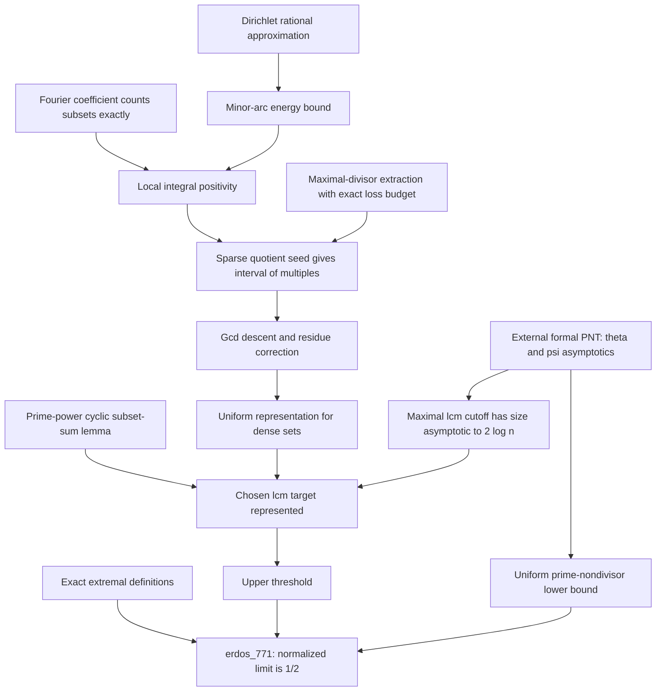

# Mathematical audit of JSP-000632 and Erdős #771

**Applicant clarification:** The applicant has since stated that they are the original contributor and requested submission. The active decision is GO for application preparation and attribution verification; see `../REPORT.md` and `../submission/STATUS.md`. Earlier personal-attribution assumptions below are historical, not an independent finding that the applicant is unrelated to the public source. The source, mathematical and build findings remain unchanged.

**Final verification addendum (12:17 HKT, 30 October 2026):** The pinned public target compiled successfully, and a separate audit printed only `propext`, `Classical.choice`, and `Quot.sound` for both final declarations. `FaithfulnessAudit.lean` also compiled, proving its explicit original predicate/maximum equal the prior proof's definitions and restating the full limit via that proof. See `../REPORT.md` and `../logs/reproduction-axiom-audit.log`. Earlier pending statements below describe the source-review checkpoint and are superseded by these executed results. This establishes no new authorship, official prize acceptance, or payment.


Audit date: 2026-10-30. This is an independent statement and proof-architecture review. It is not a certificate of Lean compilation; the reproduction agent is checking the executable artifact separately.

## Decision-relevant findings

1. The exact, well-posed problem supported by the cited literature is Erdős #771, with the ambient set **the interval of positive integers `{1,...,n}`**. The official JSP heading and description instead say “an arbitrary finite integer set.” They supply no formula or quantifiers. Read literally, this is a materially underdetermined different problem. The paper does not state a theorem for an arbitrary host set of a specified cardinality. This discrepancy was reported immediately to the coordinating agent and triggers the user's ambiguity stop condition for a new JSP formalization.
2. Alon–Freiman do resolve the full asymptotic question in #771, not merely an order-of-magnitude estimate. Their upper bound combines with the earlier uniform lower bound to give leading constant `1/2`.
3. A pre-existing candidate formalization was found during the audit. Its definitions and final theorem match #771 exactly. The reviewed copy is `research/eligibility/Erdos771-pinned.lean`, from commit `8822f7ddef30fadbd92e1c6ab4ed897af356af5e` of `plby/lean-proofs`. Mathematical equivalence passes the source-level review below. Compilation and transitive axiom checking remain separate obligations.
4. New proof construction was stopped after finding the prior candidate. The remainder of this audit concerns equivalence, independent mathematical checks, and the candidate's architecture. No Lean files were changed by this auditor.

## Sources actually inspected

- [Official catalogue entry](https://github.com/TheJustinSunPrize/awards/blob/main/problems/catalog-0601-0700.md#JSP-000632): heading, description, status and paper citation.
- [Exact LaTeX for Erdős #771](https://www.erdosproblems.com/latex/771): retrieved by direct HTTP after the web reader returned 403. Local snapshot: `research/math-audit-sources/erdos-771.html`, relevant lines 388 and 393.
- [Alon–Freiman paper](https://web.math.princeton.edu/~nalon/PDFS/Publications/On%20sums%20of%20subsets%20of%20a%20set%20of%20integers.pdf): all pages in the dependency chain, including visual inspection of printed pages 298–305. Local copy: `research/math-audit-sources/alon-freiman-1988.pdf`; rendered pages in that directory. The OCR is unreliable for exponents and inequalities.
- [Pinned candidate Lean source](https://github.com/plby/lean-proofs/blob/8822f7ddef30fadbd92e1c6ab4ed897af356af5e/src/latest/ErdosProblems/Erdos771.lean): the local pinned copy was read directly, including all target definitions, analytic theorem interfaces, extraction and extension interfaces, explicit parameter choices, target representation proof, and final limit argument.

## Exact target and quantifiers

For a finite set `S` of positive integers put

\[
\Sigma(S)=\left\{\sum_{a\in A}a:A\subseteq S\right\}.
\]

The empty subset is allowed, so `0` is always a subset sum. The target `m` is positive, so this causes no exception.

Define

\[
P(n,k)\iff
\forall m\in\mathbb N_{>0}\;\exists S\subseteq\{1,\ldots,n\},
\quad |S|=k\ \land\ m\notin\Sigma(S),
\qquad
f(n)=\max\{k\in\{0,\ldots,n\}:P(n,k)\}.
\]

The target is

\[
\lim_{n\to\infty}\frac{f(n)}{n/\log n}=\frac12,
\]

where `log` is the natural logarithm. Equivalently, for every real `δ>0` there is `N` such that every integer `n≥N` satisfies

\[
\left|\frac{f(n)\log n}{n}-\frac12\right|<\delta.
\]

The choice of `S` depends on `m`; moving the existential quantifier before the universal one would be false for any nonempty `S`. There is no arbitrary host set, no negative target, and no multiset in this formulation.

For comparison with the paper's notation let

\[
F(n,m)=\max\{|S|:S\subseteq[1,n],\ m\notin\Sigma(S)\}.
\]

Then `f(n)=min_{m≥1} F(n,m)`. This identity uses downward closure: if an avoiding set has cardinality at least `k`, one can choose a `k`-element subset. The minimum exists since `F(n,m)` takes values in `{0,...,n}`. Therefore an upper bound requires one target represented by every sufficiently large set, whereas a lower bound must work uniformly for every positive target.

## Exact equivalence of the pinned Lean target

The following are existing declarations, not new code written in this audit:

```lean
def AvoidsSubsetSum (m : ℕ) (S : Finset ℕ) : Prop :=
  m ∉ S.subsetSum

def AdmissibleCard (n k : ℕ) : Prop :=
  ∀ m : ℕ, 0 < m →
    ∃ S : Finset ℕ,
      S ⊆ Finset.Icc 1 n ∧ S.card = k ∧ AvoidsSubsetSum m S

noncomputable def erdosF (n : ℕ) : ℕ :=
  Nat.findGreatest (AdmissibleCard n) n

theorem erdos_771 :
  Tendsto (fun n : ℕ =>
    (erdosF n : ℝ) / ((n : ℝ) / Real.log (n : ℝ)))
    atTop (𝓝 (1 / 2 : ℝ)) := ...
```

Statement audit:

- Lines 42–56 use the exact `∀m>0 ∃S` order and exact cardinality.
- `Finset.Icc 1 n` excludes zero and includes `n`. Natural-number subsets of this interval are equivalent to integer subsets of it; no arithmetic information is lost.
- Lines 58–67 establish feasibility of cardinality zero and the maximal cardinality's defining property. Restricting the maximum to `k≤n` is legitimate because every subset of the interval has at most `n` elements.
- Lines 69–85 prove downward closure and the equivalence between admissibility and being below the maximum.
- `Finset.mem_subsetSum_iff` is used at, for example, lines 466–469 and 493 onward to obtain an actual subset and its sum; the intended finite subset semantics are exercised by the proof.
- Lines 4528–4556 assert convergence at `atTop`, without hypotheses left on `n`, no restricted subsequence, and no changed constant. Values at `n=0,1`, where Lean's totalized division/logarithm differ from informal notation, do not affect an eventual limit.
- The final `Iff.mp ... trivial` wrapper is harmless: its nontrivial direction explicitly invokes `erdosF_asymptotic`. It does not prove the target from `True` without that theorem.
- The source contains no `sorry` or `admit`, and no new `axiom` declaration was found by the text scan. This does **not** replace the compilation and transitive `#print axioms` audit.

Conclusion: conditional on successful kernel checking and a clean transitive axiom audit, this is a complete formalization of #771. It is not a formalization of an unspecified arbitrary-host-set generalization.

## What the paper provides

Theorem 1.2 (p.298) gives, for each `ε>0` and sufficiently large `n`,

\[
3n^{5/3+\varepsilon}<m<\frac{n^2}{20(\log n)^2}
\implies
F(n,m)=\lfloor n/s\rfloor+s-2,
\quad s=\min\{d\ge1:d\nmid m\}.
\]

The analytic starting point is Proposition 1.3: for `A⊆[1,n]`, `x=|A|>n^(2/3+ε)`, and at least `n^(2/3)` nonmultiples of every integer `q≥2`, all integers within `B=(Σa²)^(1/2)/2` of `S=Σa/2` are subset sums. The later progression and residue arguments turn local representation into the exact formula. A maximal lcm below a quadratic/polylogarithmic threshold supplies the difficult target. The prime number theorem determines its least nondivisor asymptotically.

For a formalization of the paper's route, the precise intermediate contracts are as follows. All statements with `ε` have quantifiers `∀ε>0 ∃n₀ ∀n>n₀`; the threshold is uniform over the finite sets and targets subsequently quantified.

- **Lemma 3.1:** if `x>n^(2/3+ε)` and `#{a∈A:q∤a}≥x/(2log n)` for every integer `q≥2`, then every integer in `[(1−1/(4log n))S_A,S_A]` belongs to `Σ(A)`, where `S_A=ΣA/2`.
- **Lemma 3.2:** if `x>2n^(2/3+ε)`, there are `1≤k≤2n/x` and `B⊆A`, `|B|≥x/2`, with all elements divisible by `k`. Writing `D=B/k` and `S_D=ΣD/2`, every integer in `[(1−1/(4log n))S_D,S_D]` belongs to `Σ(D)`.
- **Lemma 3.4:** if `x>3n^(2/3+ε)log n`, there are `G⊆A`, `t=|G|≥x−n^(2/3)` and `1≤q≤n/t`, with `q` dividing every member of `G`. Put `S=ΣG` and `Δ=n^(2/3+ε)S/t+n^(4/3)log n`. Every integer multiple of `q` in `[Δ,S−Δ]` belongs to `Σ(G)`.
- **Lemma 4.2:** for prime `p`, exponent `a≥1`, and a sequence of `p^a−1` nonzero elements of `Z/(p^a)`, each `i p^(a−1)`, `1≤i≤p−1`, is a subset sum. Repeated residues are permitted; the positions are distinct.
- **Lemma 4.3:** if `1≤s≤3log n` and `|A|≥floor(n/s)`, some `1≤q≤s` has every multiple of `q` in `[n^(5/3+ε),n²/(20(log n)²)]` represented using only elements of `A` divisible by `q`. The printed proof's factor-of-two issue is analyzed below.

Thus the paper route needed for a full exact formula is `Proposition 1.3 → 3.1 → 3.2 → 3.4 → 4.3`, followed by the prime-power correction in 4.2 and the sharp fixed-target lower construction in 4.1. Lemma 3.3 and Proposition 1.1 concern forbidden powers and are unnecessary for #771. Existence of the least nondivisor, its prime-power property, and the PNT conversion of lcm growth are independent number-theoretic dependencies.

## Independent mathematical reconstruction of the asymptotic conclusion

This section gives the auditor's own derivation, making the quantifier and endpoint checks explicit.

### Uniform lower bound

Fix `c>2`, let `Q=ceil(c log n)`, and take `n` sufficiently large depending only on `c`. The prime number theorem gives `θ(Q)>2 log n`, hence the primorial through `Q` exceeds `n²`. For every `1≤m≤n(n+1)/2≤n²`, some prime `p≤Q` fails to divide `m`. Otherwise that primorial would divide the positive integer `m`, contradicting its size. The multiples of `p` in `[1,n]` form an avoiding set of size `floor(n/p)≥floor(n/Q)`.

If `m>n(n+1)/2`, every subset of `[1,n]` avoids `m`. Thus the same common cardinality works uniformly for all positive `m`. The strict `>` here avoids the source webpage's informal equality-endpoint shortcut. Dividing by `n/log n` gives an eventual lower bound tending to `1/c`; letting `c↓2` gives liminf at least `1/2`.

### Lcm target and range check

Let `L(r)=lcm(1,...,r)` and `X(n)=floor(n²/(40(log n)²))`. Choose the maximal `r` with `L(r)≤X`. Then

\[
L(r)\le X<L(r+1)\le(r+1)L(r).
\]

By `log L(r)=ψ(r)~r`, one gets `r~log X~2log n`. Set `m=L(r)`. The displayed inequalities imply `m>X/(r+1)`, so `m` has order at least `n²/(log n)³`, and consequently exceeds `3n^(5/3+ε)` eventually for any fixed `0<ε<1/3`. The factor `40` ensures the strict upper endpoint needed by Theorem 1.2, even after rounding. Also `snd(m)=r+1`: all integers up to `r` divide `m`, while `r+1` dividing `m` would contradict maximality of `r`.

The exact formula now gives

\[
F(n,m)=\lfloor n/(r+1)\rfloor+r-1
       =\left(\frac12+o(1)\right)\frac n{\log n}.
\]

The rounding error is at most one; the additive `r=O(log n)` term is negligible after normalization because `(log n)²/n→0`. Since `f(n)≤F(n,m)`, this proves the upper bound. All asymptotics here depend only on `n`, or on the one fixed `ε`; there is no unjustified uniformity in a moving target.

### Optional shorter mathematical route

The full exact formula is stronger than #771 needs. A progression result asserting that every `A` with `|A|≥floor(n/r)` represents all multiples of some `q≤r` throughout the relevant target range suffices, because `q|L(r)`. This bypasses the least-nondivisor prime-power endpoint. This is an independently observed simplification, **not** a claim about what the inspected Lean file formalizes: the existing file does include the prime-power endpoint argument.

## Architecture actually used by the candidate

The candidate proves the exact final asymptotic while replacing the paper's sharp intermediate bounds with explicit bounds that are sufficient for that final target. This is legitimate: weakening an intermediate lemma is not weakening the requested final statement.



Significant interfaces, statements and constants:

| Block / existing declaration | Mathematical content | Role and difficulty |
|---|---|---|
| `AdmissibleCard`, `erdosF_spec`, `mono_card` (42–85) | Exact maximum and downward closure | Elementary finset engineering; already present in candidate |
| `eventually_exists_prime_nondivisor` (600) | For each fixed `c>2`, eventually every `0<m≤n(n+1)/2` has a prime nondivisor at most `ceil(c log n)` | Uniform lower bound; requires formal PNT |
| `coefficientIntegral_eq` (819) | Integral over `[-1/2,1/2]` equals number of representing subsets divided by `2^|A|` | Exact finite Fourier expansion and character orthogonality; substantial analysis engineering |
| `circleEnergy_minorArc_lower` (2084) | If every relevant small modulus misses `h` members, energy is at least `h(x/(512·1001(n+1)))²` outside `|t|<1/(1000n)` | Rational approximation and residue occupancy; substantial arithmetic/analytic engineering |
| `mem_subsetSum_of_sparse` (2150) | If `h≤x/2`, the modulus nonconcentration condition holds, `|ΣA/2−M|≤100n`, and `exp(−E)<3ρ/4`, then `M∈Σ(A)`; `ρ=1/(10^6 n(x+1))` | Local positivity, sufficient without a full Gaussian local limit theorem |
| `extractionDivisor_sparse` (2566) | A maximal divisor under loss budget `h log₂q` gives a quotient with at least `h` nonmultiples for every `q≥2` | Avoids informal iterative/log-base bookkeeping; finitary |
| `exists_sparse_seed_progression` (2637) | A retained quotient seed yields multiples of `k` from `kc` to `k(c+99n)` | Analytic input converted to finite interval coverage |
| `exists_stable_progression` (2436) | Gcd descent ends at `q|k` with fewer than `q²` exceptions, adds at most `2k` elements, loses at most `2kn` at the lower endpoint | Disjoint residue correction, finite strong induction |
| `uniform_divisible_representation` (2945) | Explicit four numerical hypotheses yield some `1≤q≤s` covering every multiple of `q` in `[R,V]` using only the divisible part of `A` | Essential disjointness guarantee for later residue correction |
| `exists_subset_sum_mod_primePower` (424) | At least `p^a−1` nonzero residues cover every target in the subgroup of order `p` | Finite cyclic group growth; no asymptotics |
| `afTarget_mem_subsetSum` (4087) | Every set above the explicit cardinality threshold represents the chosen positive lcm target | Splits `q<s` (divisibility) and `q=s` (prime-power residue correction) |
| `afCardThreshold_ratio_tendsto_half` (4451) | The threshold divided by `n/log n` tends to `1/2` | PNT cutoff plus negligible polylogarithmic errors |

The explicit parameters are

\[
B=\lfloor\log_2 n\rfloor+1,\quad y=\lfloor n/B^8\rfloor,
\quad h=\lfloor n/B^{20}\rfloor,
\quad R=\lfloor n^2/(10000B^3)\rfloor,
\quad V=\lfloor n^2/(1000B^2)\rfloor.
\]

With `s=lcmCutoff(V)+1`, the threshold is

\[
K(n,s)=\lfloor n/s\rfloor+16B^{16}+s.
\]

The finite representation theorem is used only once `n>10^7`, `B>256(512·1001)²`, and `B^38≤n/2`, together with `s≤3B`. These enormous thresholds are mathematically harmless for an asymptotic theorem. Each condition holds eventually; none is left as an assumption in the final result. The extra normalized error is `O((log n)^17/n)+O((log n)^2/n)`, hence tends to zero.

The proof's numerical hypotheses are uniform over every retained seed size `x` in `[y−h log₂n,y]`. The selected target has margin `R+sn≤m≤V`; a residue correction uses at most `s−1` original elements, with sum at most `(s−1)n`. Thus the residual target stays in `[R,V]`, and the correction uses elements outside the divisible part. This addresses both the moving-target and disjointness obligations explicitly.

## Source defects and proof obligations found

These are not evidence that the final asymptotic is false.

1. **Catalogue mismatch (material):** the arbitrary-host-set wording differs from #771 and is not resolved by selecting a convenient formal interpretation. A submission needs an authoritative target, or explicit acceptance that #771 is intended.
2. **Lemma 4.3 endpoint bookkeeping:** visual inspection of p.305 shows `n^(5/3+ε)≤m` in the statement, but the proof bounds the lower error by `2n^(5/3+ε)`, and the following theorem proof uses that factor `2`. It is repaired by applying the preceding lemma with a smaller exponent `ε'<ε`, since `2n^(5/3+ε')≤n^(5/3+ε)` eventually. The pinned proof uses exact finite inequalities instead.
3. **Other printed/OCR hazards:** the proof of Lemma 4.3 contains a sum bound whose displayed endpoint is difficult to reconcile literally with the available set size. Use the direct cardinality inequality `t≥floor(n/s)−n^(2/3)` and `ΣG≥t(t+1)/2`; this gives the required `n²/(19 log² n)` lower bound eventually when `s≤3log n`. Also residue classes in `[1,n]` have at most `ceil(n/q)` members, not always `floor(n/q)` as printed in the analytic proof; the weaker bound `2n/q` used subsequently remains valid for `q≤n`.
4. **Hidden constants and exponents:** floors in the arc parameter and truncated prefixes require additive or constant-factor slack. A proof cannot use a floor as though it were its unrounded real value. Every appeal to a smaller exponent must be explicit in Lean.
5. **Logarithm bases in iteration:** the paper's informal “at most log n steps” statements require checking against the natural logarithm convention. Density bounds can repair the extraction count; the existing candidate instead tracks `Nat.log 2` exactly and uses a geometric `2k` descent budget.
6. **Main dependency:** the exact constant `1/2` uses PNT-level input. Elementary coarse prime bounds would not recover it. `PrimeNumberTheoremAnd.Consequences` is explicitly imported by the candidate; this is vendored project source outside stock Mathlib, not merely a tactic. Its `WeakPNT''` theorem is proved at line 97 from `WeakPNT'`, which invokes `WeakPNT` in `PrimeNumberTheoremAnd/Wiener.lean:2247`. The latter is a Wiener–Ikehara/PNT development. The pinned repository and its transitive axiom provenance must be included in reproduction.
7. **No independent full kernel result yet:** reading a complete-looking proof, or finding `#print axioms` in its source, does not establish that it compiles in the claimed environment. This audit makes no such claim. The coordinating reproduction results must be appended to the final report.

## Paper-to-code correspondence and verified library support

The mapping is by mathematical role, not an assertion that every stronger statement in the paper is formalized.

| Paper item | Role in paper | Candidate counterpart / distinction |
|---|---|---|
| Proposition 1.3 | Local subset-sum central limit estimate; existence and asymptotic representation count | `LocalLimit.mem_subsetSum_of_sparse`; only local existence within `100n` of the center is required. It does not claim the paper's full representation-count asymptotic. |
| Lemma 3.1 | Widen local coverage by using ordered prefixes | No exact counterpart is needed: the candidate's initial interval has `99n` width before rescaling, enough for its later extension argument. |
| Lemma 3.2 | Extract a large subset and common divisor until quotient is nonconcentrated | `GoodDivisor`, `extractionDivisor_sparse`, `exists_sparse_seed_progression`; exact logarithmic budget replaces informal iteration. |
| Lemma 3.3 | Convenient progression reformulation for forbidden powers | Not required for #771; no need to formalize the forbidden-powers application. |
| Lemma 3.4 | Gcd refinement followed by adding unused divisible elements produces long interval coverage | `exists_stable_progression`, `CoversMultiples.add_finset`, `exists_long_multiples`, `uniform_divisible_representation`. |
| Lemma 4.1 | Sharp lower construction for the exact fixed-target function | Not needed for #771's asymptotic; `admissible_of_bounded_prime_nondivisors` supplies the sufficient uniform lower bound. |
| Lemma 4.2 | Prime-power cyclic residue correction | `primePower_socle_is_nsmul`, `cyclicSubsetSum_card_lower_of_not_mem`, `exists_subset_sum_mod_primePower`. |
| Lemma 4.3 | Dense set covers all multiples of some small modulus in a wide target range | `af_uniform_representation`, with changed explicit thresholds sufficient for the final asymptotic. |
| Theorem 1.2 | Exact value of the two-variable extremal function on a specified range | **Not** the formalized final theorem. `afTarget_mem_subsetSum` provides the weaker intermediate fact sufficient for the complete #771 limit. |
| p.298 consequence plus Erdős–Graham lower bound | The full #771 asymptotic | `erdosF_asymptotic` and `erdos_771`. |

The following availability claims were checked against the actual pinned Mathlib source, rather than guessed from theorem names. Paths in this table are relative to `reproduction/lean-proofs/src/latest/.lake/packages/mathlib/Mathlib`.

| Topic | Source-verified stock Mathlib support | What remains custom |
|---|---|---|
| Distinct finite subset sums | `Finset.subsetSum` at `Combinatorics/Additive/SubsetSum.lean:37`; `Finset.mem_subsetSum_iff` at line 39 | Interval coverage, divisor extraction and long progression package |
| Finite cyclic groups | `ZMod.card` at `Data/ZMod/Defs.lean:166`; `ZMod.natCast_eq_natCast_iff` at `Data/ZMod/Basic.lean:507` | Prime-power socle coverage and cyclic growth argument |
| Character integrals | `integral_exp_mul_complex` at `Analysis/SpecialFunctions/Integrals/Basic.lean:242` | `integer_character_integral`, finite Bernoulli expansion, coefficient-count identity |
| Rational approximation | `Real.exists_rat_abs_sub_le_and_den_le` at `NumberTheory/DiophantineApproximation/Basic.lean:147` | Endpoint normalization and residue-energy bounds |
| Gaussian integration | `integral_gaussian` at `Analysis/SpecialFunctions/Gaussian/GaussianIntegral.lean:211`; `integral_cexp_neg_mul_sq_add_real_mul_I` at `Analysis/SpecialFunctions/Gaussian/FourierTransform.lean:133` | A full uniform local CLT would still require custom estimates; the candidate instead uses direct positivity and does not need this Gaussian transform route |
| Chebyshev/lcm identities | `Chebyshev.theta_eq_log_primorial` at `NumberTheory/Chebyshev.lean:188`; `Chebyshev.psi_eq_log_lcmUpto` at line 311 | PNT asymptotics supplied by vendored `PrimeNumberTheoremAnd`, not inferred from these identities |

Source-verified custom support reused by `Erdos771.lean` includes:

- `Erdos88.Fourier.abs_cos_le_exp_neg_centeredModOne_sq`, in `ErdosProblems/Erdos88/Fourier.lean:339`.
- `Erdos387.card_modularPreimage`, in `ErdosProblems/Erdos387/LocalDensity.lean:274`.
- `Erdos387.binaryLogScale`, `binaryLogScale_cast_le_three_mul_log`, and `eventually_binaryLogScale_pow_le_half`, in `ErdosProblems/Erdos387/UniformAnalyticInputs.lean:19,22,374`.
- The cyclic subset-sum list and its cardinality-growth interfaces in `ErdosProblems/Erdos54/CyclicGrowth.lean`, including `cyclicSubsetSumResiduesList` at line 38 and `card_cyclicSubsetSumResiduesList_append_singleton` at line 102.
- `PrimeNumberTheoremAnd/Consequences.lean:97` and `PrimeNumberTheoremAnd/Wiener.lean:2247` as described above.

The manifest pins Mathlib revision `db584cd6d46c92f209a44c0f1c829460d327499d` (`v4.33.0`). Finding these source declarations establishes availability in that checkout, not successful build status or a complete transitive axiom audit.

## Feasibility assessment

There is no identified unresolved mathematical obstacle to #771. The substantial work is formal analysis, exact finite interval/residue combinatorics, and formal prime number theorem dependencies. The pre-existing 4,560-line candidate demonstrates a concrete architecture and supplies much of this infrastructure, but its existence also removes the basis for claiming this source as a new original formalization.

For a fresh proof from plain Mathlib, the local Fourier positivity theorem and the long-multiples extraction are the principal engineering bottlenecks; PNT provenance is a separate large dependency. A second model may improve adversarial statement review, but it does not remove these dependencies or establish novelty. Given the user's stop conditions, the appropriate next work is bounded reproduction and provenance verification of the existing candidate, not speculative original implementation.
